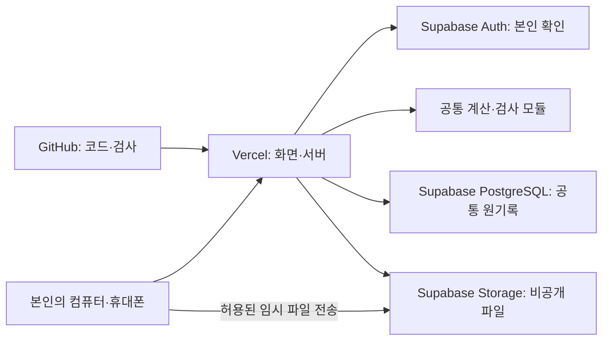

# 카페 판매·손익·재고 관리 기술 요구사항 문서(TRD)

작성일: 2026-10-12  
상태: v1. 사용자의 추천안 위임에 따라 구현 방법 결정 완료. 실제 개발·계정 설정·GitHub 업로드·Vercel 배포를 완료한 문서는 아님.

TRD는 기능을 어떤 기술과 구조로 만들고, 기록을 어떻게 보호·저장·복구할지 정하는 문서다. 기술 선택은 이 문서에서 결정하지만 기능·사용 순서·계산 기준은 PRD와 FRD를 그대로 따른다.

## 1. 기준 문서와 변경하지 않는 요구사항

기준은 `docs/01_PRD.md`, `docs/02_FRD.md`, `design/artisan_ledger/DESIGN.md`, `design/_1~_3/code.html` 및 각 `screen.png`다. 원자료는 `매장운영데이터/데이터설명.md`와 동일 폴더 JSON·엑셀이다.

- 한 매장, 사용자 본인 한 명, 컴퓨터·휴대폰에서 같은 기록 사용, 본인만 접근.
- 판매 입력 → 운영비 부담을 포함한 메뉴 수익성과 등급 → 일·월 손익·재고 확인의 흐름 유지.
- 판매·비용 입력/수정/삭제, 입고·폐기·실측 재고 입력, 이미 떨어진 재료 확인, 전체 JSON 백업과 전체 교체 복원 유지.
- 운영비는 **날짜·비용항목별 순매출 비중**으로 배분한 뒤 월을 합산. FRD의 원 단위 잔여액 배분 방법 유지.
- S≥20%, A≥10%·<20%, B≥0%·<10%, C<0%. 판정 불가를 C로 대신하지 않음.
- 판매 원가·수수료 보존 및 조건 변경에 따른 원가 재산출, 실측 재고를 그날 마지막 수량으로 반영하는 기준 유지.
- 미마감·공백·미래일을 0 실적으로 바꾸지 않음. 비용계획과 비용기록, 실측과 증감, 판매 재료 사용을 중복 반영하지 않음.
- POS·센서·자동 백업·자동 마감·보고서 내보내기·재고기록 수정/삭제 등 제외 기능을 추가하지 않음.

이번 사용자 지시로 코드 보관처는 GitHub, 배포처는 Vercel로 확정했다. PRD·FRD에 미정으로 남아 있던 배포 플랫폼만 이 문서에서 구체화한다. 원래 문서와 시안은 수정하지 않는다.

## 2. 추천 기술과 선택 이유

| 용도 | 채택 기술 | 쉬운 설명과 이유 |
| --- | --- | --- |
| 화면과 서버 | Next.js App Router, React, TypeScript | 화면과 기록 처리 서버를 한 프로젝트에서 만든다. TypeScript는 잘못된 값 종류를 개발 중 찾는 도구다 |
| 실행 환경 | Vercel의 Node.js 런타임 | 브라우저 밖에서 로그인 확인·계산·저장을 실행한다. DB 연결이 필요한 처리는 Edge 런타임으로 분산하지 않는다 |
| 디자인 | Tailwind CSS와 공통 React 구성요소 | 시안의 색·간격·표·입력창을 재사용하여 빠르게 일관된 화면을 만든다 |
| 입력 검사 | Zod | 날짜·수량·금액·백업 파일에 필요한 값이 있는지 같은 규칙으로 검사한다 |
| 계산 | 공통 TypeScript 계산 모듈, decimal.js 및 정수/분수 보조 연산 | 금액의 소수와 배분 경계에서 일반 소수 계산 오차를 방지한다 |
| 기록 저장 | Supabase의 PostgreSQL | 판매·비용·재고를 인터넷의 공통 저장소에 보관한다. 어떤 기기에서 접속해도 같은 자료를 사용한다 |
| 본인 확인 | Supabase Auth의 이메일·비밀번호 로그인 | 사용자 본인 계정을 미리 만들고 다른 사람의 가입을 막는다. 직접 비밀번호 저장 기능을 만들지 않는다 |
| DB 접속 | Postgres.js와 Supabase transaction pooler | 서버가 DB 연결을 빌려 사용한다. 여러 기록을 한 번에 성공시키거나 전부 취소할 수 있다 |
| 백업·복원 전송 | Supabase Storage의 비공개 임시 공간 | 파일을 공개하지 않고 큰 JSON을 옮긴다. 영구 백업 이력 기능은 만들지 않는다 |
| 검사 | Vitest, Playwright, TypeScript 검사, ESLint | 계산·실제 저장·브라우저 흐름·코드 오류를 각각 확인한다 |
| 코드 보관·배포 | GitHub 비공개 저장소, GitHub Actions, Vercel | 변경 기록을 보관하고 검사 후 같은 코드를 배포한다 |

Node.js는 구현 시 Vercel에서 지원하는 LTS 버전, Next.js는 호환되는 안정판을 사용한다. 개발 시작 때 검증한 정확한 버전을 `package.json`, 잠금 파일, 실행 버전 파일에 고정하고 자동으로 최신 버전으로 바뀌지 않게 한다. 미확인 버전 번호를 문서에서 임의로 쓰지 않는다. 기본 도구 구성이 공식 설치 흐름과 호환되는지 확인한다. [Next.js 설치 문서](https://nextjs.org/docs/app/getting-started/installation)

Supabase는 서울 `ap-northeast-2`, Vercel 서버도 서울 `icn1`을 우선 선택한다. 실제 생성 화면에서 지역을 확인한다. 기록 날짜의 한국 시간 처리는 서버 지역과 별개로 고정한다. 지역 선택이 모든 서비스의 정보가 국내에서만 처리된다는 보장은 아니다. [Supabase 지역](https://supabase.com/docs/guides/platform/regions), [Vercel 실행 지역](https://vercel.com/docs/functions/configuring-functions/region)

## 3. 전체 구조와 역할

브라우저는 입력과 결과 표시를 담당한다. 서버는 매 요청에서 본인 확인, 입력 검사, FRD 계산, DB 저장을 수행한다. DB는 원기록과 버전을 보존한다. 파일 공간은 백업 다운로드·복원 업로드 중에만 사용한다. GitHub에는 코드와 가상 검사 자료를 보관하고 매장의 실제 운영 자료를 넣지 않는다.

브라우저가 보낸 순매출·원가·등급·재고 잔량을 저장 결과로 신뢰하지 않는다. 서버가 날짜·메뉴·수량 등의 원입력과 저장된 기준 자료로 다시 계산한다. 브라우저 미리보기는 공통 모듈로 계산할 수 있지만 최종 판정·저장은 서버 결과를 쓴다.

## 4. 화면 구현과 시안 반영

| 경로 | 화면 | 연결할 FRD |
| --- | --- | --- |
| `/login` | 본인 로그인 | F01 |
| `/sales` | 판매 기록·등록/수정 창 | F02~F04 |
| `/profitability` | 메뉴 수익성·등급·상세 창 | F07 |
| `/performance` | 일별·월별 실적 및 손익 | F06 |
| `/inventory` | 재고기록 입력·잔량·소진 재료 | F08·F09 |
| `/expenses` | 비용 목록·입력/수정 | F05 |
| `/backup` | 전체 백업·복원 내용 확인 | F10·F11 |

시안은 React 화면으로 옮긴다. Tailwind 실행용 CDN 스크립트와 임시 알림 코드는 제품 코드로 복사하지 않는다. 저장·파일 생성 성공은 실제 서버 결과로 판단한다. 목록·요약·차트는 같은 결과 자료에서 그리며 별도의 예시 금액을 넣지 않는다.

공통 구성요소는 기간 선택, 상태 안내, 금액·수량 입력, 기록 표, 등록/수정 창, 삭제 확인, 재료 상태, 수익성 상세, 복원 확인 창이다. 여러 입력·기록 기능에서 같은 오류 표시와 취소 동작을 쓴다.

컴퓨터는 시안의 표·옆 메뉴를 유지하고, 휴대폰은 필수 정보가 보이는 목록과 접을 수 있는 상세를 사용한다. 긴 표는 필요한 경우 가로로 이동할 수 있게 한다. 360px 화면에서도 저장·취소·기간 선택을 사용할 수 있게 검사한다. 팝업은 키보드 이동·초점 복귀·닫기 버튼을 지원하고, 미저장 값이 있을 때는 FRD의 취소 확인을 적용한다.

폰트와 아이콘은 라이선스를 확인한 후 프로젝트에 묶어 제공하고, 시안의 외부 이미지 주소에 의존하지 않는다. 등급·소진·오류는 색뿐 아니라 글자로도 표시한다. 시안의 없는 비용·재고·복원·로그인 화면은 기존 공통 요소로 보완하며 새로운 업무 기능은 추가하지 않는다.

## 5. 데이터 저장 구조

### 5.1 기록별 표

PostgreSQL의 표는 엑셀 시트처럼 같은 종류의 기록을 모으는 공간이다. 데이터는 인터넷 공통 DB에 저장하며 Vercel 파일, 브라우저 저장소, GitHub 파일을 매장 기록의 원본으로 쓰지 않는다.

| 표 | 핵심 저장 내용·제약 |
| --- | --- |
| `stores` | 매장 ID, 본인 Auth ID, 자료 구분, 초기재고 기준일, 현재 자료 버전, 복원 세대 번호 |
| `suppliers` | 공급사 ID·이름. 매장 내 ID 중복 금지 |
| `materials` | 재료 ID·이름·단위·구매용량·최초가격·납기·안전재고 일수·공급사 ID |
| `menus` | 메뉴 ID·이름·판매기준가·분류·레시피버전 |
| `recipes` | 레시피버전·메뉴·재료·사용량·단위·적용채널. 원래 빈 적용채널은 전체 의미 유지 |
| `price_history` | 재료·적용시작일·구매가격·구매용량. 같은 재료·적용일 중복 금지 |
| `calendar` | 날짜·영업여부·마감여부·날씨·메모. 새 날짜 저장은 마감 완료를 자동 생성하지 않음 |
| `sales` | 판매 ID·날짜·메뉴·채널·수량·당시단가·할인·순매출·수수료·레시피버전·개당 원가 스냅샷·행 버전 |
| `opening_inventory` | 재료·기준일·수량·단위 |
| `inventory_events` | 기록 ID·날짜·재료·유형·증감·단위·사유·입고 단위원가·공급사·실측수량 |
| `expenses` | 비용 ID·귀속일·항목·금액·원기록 배분기준/직접 입력 구분·행 버전 |
| `monthly_expense_plan` | 월·비용항목·금액. 실적 비용 집계에서 제외 |
| `dataset_meta` | 자료 출처·기간·버전 등 원자료 정보 |
| `calculation_settings` | FRD D01~D10·C01~C08을 재현할 설정·정책 버전. 사용자 편집 화면 없음 |
| `mutation_receipts` | 저장 요청 ID·처리 결과·해당 자료 버전. 중복 저장 방지용 내부 기록 |
| `transfer_jobs` | 백업/복원 요청 ID·본인 ID·임시 경로·해시·만료·처리 상태. 영구 백업 이력이 아님 |

모든 업무 표에는 `store_id`를 넣고, 다른 매장의 ID와 연결되지 않도록 복합 참조를 검사한다. 원자료의 S/M/I/E/X/V ID는 보존하고 새 기록은 충돌 없는 ID를 발급한다. 백업에서도 원기록 ID를 유지한다.

DB 제약으로 판매의 날짜·메뉴·채널 중복을 막고, 같은 날짜·재료의 실측을 하나로 제한한다. 비용은 같은 날짜·항목의 여러 기록을 허용한다. 실측 없는 증감 조정은 원자료 보존·계산용으로만 읽고 사용자 입력 유형을 늘리지 않는다.

### 5.2 날짜·숫자·빈칸

- 판매·비용·재고의 업무 날짜는 `DATE`, 생성·수정시각은 UTC의 `TIMESTAMPTZ`. 표시와 오늘 날짜 검사는 `Asia/Seoul`을 명시한다.
- 정수 원 금액은 정수 제약이 있는 `NUMERIC`, 수량·가격·원가는 정확한 소수형 `NUMERIC`을 사용한다. DB의 소수를 JavaScript `Number`로 자동 변환하지 않고 문자열로 전달한다.
- g·ml 입력은 FRD대로 소수 3자리까지, 개는 정수. 과거 자료의 원가 소수 자릿수를 줄이지 않는다. 구매용량 0·음수 등은 차단한다.
- 빈칸은 `NULL`, 실제 0은 숫자 0, 예/아니오는 boolean이다. 기존 값이 비어 있는 선택 항목은 자동 0으로 채우지 않는다.
- 새 원가에서 나눗셈이 끝나지 않는 경우 계산 보조값에 분자·분모를 보존한다. 저장 원가 표시용 소수만으로 나중에 더 낮은 정밀도로 다시 계산하지 않는다. 원자료의 유한 소수 스냅샷은 그 값을 정확하게 보존한다.
- 판매·원가·수익 결과의 표시 반올림은 FRD 그대로다. 계산 단계에서 표시용 반올림 값을 재사용하지 않는다.

### 5.3 찾기 속도

자주 찾는 매장·날짜, 메뉴·날짜, 재료·날짜, 비용 날짜·항목, 가격 재료·적용일에 인덱스를 둔다. 인덱스는 필요한 기록을 빠르게 찾는 목차다. 참조·중복 검사는 DB에서 추가로 강제하여 두 기기 저장이 겹쳐도 우회되지 않게 한다.

## 6. 저장·충돌·계산의 일관성

**트랜잭션**은 여러 저장을 한 묶음으로 성공시키거나 모두 취소하는 처리다. 판매·비용·재고 변경과 결과 검증은 한 트랜잭션 안에서 끝내고, 성공 응답은 DB 저장 확정 뒤에만 보낸다.

일반 변경 순서:

1. 서버에서 인증된 본인·매장·입력·요청 ID를 검사한다.
2. 한 DB 연결에서 트랜잭션 시작, 해당 매장 제어 행을 잠근다. 다른 쓰기가 끝날 때까지 기다리거나 대기 초과를 알린다.
3. 현재 복원 세대, 대상 기록의 행 버전, 같은 요청 ID의 처리 결과를 확인한다.
4. 최신 원기록을 읽어 요청 변경을 적용한다. UI에서 보낸 원가·매출·수익을 그대로 저장하지 않는다.
5. 공통 계산 모듈로 영향을 받는 일·월 결과와 해당 날짜 이후 재고를 검증한다. 음수 재고는 FRD대로 경고 가능한 값이며 실패로 취급하지 않는다.
6. 입력 오류·중복·계산 근거 누락·합계 불일치면 전부 취소한다. 성공이면 행 버전·자료 버전을 증가시키고 요청 처리 결과와 함께 저장을 확정한다.
7. 서버 결과로 화면을 갱신한다. DB 저장 후 화면을 불러오지 못한 경우 “저장됨·화면 갱신 실패”로 구별하며 같은 변경을 다시 적용하지 않는다.

소규모 단독 사용이므로 매장 단위 쓰기는 순서대로 처리한다. 두 기기의 서로 다른 행 변경은 최신 자료에 각각 반영할 수 있다. 같은 행의 오래된 수정·삭제는 `409 Conflict`로 거부한다. 복원 세대가 바뀌면 어느 행이든 오래된 화면의 변경을 거부한다. 복원에서 예전 버전 숫자를 그대로 되돌려 충돌 검사가 무력해지지 않게 한다.

고유한 요청 ID를 같은 요청의 재전송에도 유지한다. 같은 ID·같은 내용이면 저장된 처리 결과를 돌려주고, 같은 ID·다른 내용이면 거부한다. 처리 확인용 내부 영수증은 최소 7일 보관한 뒤 정리한다. 기간이 지난 불명확한 요청은 자동 재저장하지 않고 현재 기록 확인을 안내한다.

Postgres.js는 서버 모듈 단위로 생성하며 연결 수 1, transaction pooler, prepared statement 비활성화로 시작한다. 같은 트랜잭션의 SQL은 순서대로 실행하고 session 상태·파이프라인에 의존하지 않는다. 연결마다 인증된 사용자 문맥은 `SET LOCAL`로 해당 트랜잭션에만 적용한다. TLS와 서버 인증서 검증을 사용한다. [Supabase 연결 문서](https://supabase.com/docs/guides/database/connecting-to-postgres)

## 7. 계산 모듈과 원기록 보존

계산은 `src/domain`의 순수 TypeScript 함수로 모은다. 순수 함수는 DB나 화면을 직접 바꾸지 않고 입력 자료로 결과만 만드는 함수다. 등록 미리보기·저장 검사·조회·백업 복원 후 검증에서 같은 모듈을 사용한다.

| 모듈 | FRD 대응 | 구현 책임 |
| --- | --- | --- |
| `sales-calculation` | C01·C02·C03 | 할인 전체금액, 실제 수수료, 판매일 가격·레시피 원가, 채널별 재료 사용량 |
| `performance-calculation` | C04·C05 | 일·월 실적, 비용계획 제외, 미마감 구분, 기간 합계 비율 |
| `allocation-calculation` | C06 | 날짜·항목별 배분, 몫과 잔여 원, ID 순서 동률 처리, 미배분 운영비 |
| `grade-calculation` | C07 | 반올림 전 0/10/20 경계, 판매 없음·0매출·자료 누락 판정 불가 |
| `inventory-calculation` | C08 | 초기재고부터 날짜순 재생, 판매 사용 한 번 반영, 실측 기준 고정, 음수 표시 |
| `backup-validation` | F10·F11 | 파일 형식·참조·버전·기간·단위·계산 기준 검사 |

정수 원 배분의 몫·나머지는 정수 연산으로 비교한다. 소수 가격·원가의 정확한 계산은 decimal.js와 분수 보조값을 사용한다. 등급은 비율 표시값을 비교하지 않고 `수익×100`과 `순매출×경계값`을 비교하여 경계 오차를 피한다. 전체 배분 전·후 운영비 합과 “메뉴 수익 합−미배분 운영비=매장 손익”을 검증한다.

파생 집계·잔량은 원기록에서 계산하고 1차에는 별도 영구 집계 표를 만들지 않는다. 판매 차감을 재고 이벤트로 추가하지 않는다. 매출일 이전부터 기준일까지의 재고 기록은 모두 읽되 한 요청에서 정렬·재료별 묶기를 한 번 하고 반복 조회하지 않는다.

기존 판매 스냅샷과 수수료는 보존한다. 날짜·메뉴·채널 변경 시만 FRD대로 원가를 다시 산출하고 사용자에게 바뀐 값을 보여 준다. 실사 원기록 증감은 보존하고 현재 계산 차이는 별도 결과로 반환한다. 입고 단위원가가 가격 이력을 자동 수정하지 않게 한다.

## 8. 서버 API와 화면 연결

API는 화면이 서버에 조회·저장을 요청하는 통로다. 매 요청은 인증·권한·입력 검사를 거치며, 아래 경로명은 개발 시 사용할 기술 계약이다.

| 요청 | 역할 |
| --- | --- |
| `POST /api/auth/login`, `/logout` | 본인 로그인·로그아웃. 일반 가입 경로 없음 |
| `GET /api/bootstrap` | 허용된 메뉴·재료·조회 기준·현재 복원 세대 제공. 전체 판매 자료를 내려보내지 않음 |
| `GET/POST /api/sales`, `PATCH/DELETE /api/sales/:id` | 필터 조회와 판매 변경. 수정/삭제에 행 버전·복원 세대·요청 ID 포함 |
| `GET/POST /api/expenses`, `PATCH/DELETE /api/expenses/:id` | 비용 조회·변경. 중복 가능 경고에 대한 확인 여부 검사 |
| `GET/POST /api/inventory-events` | 재고기록 조회·신규 기록. 수정/삭제 경로 없음 |
| `GET /api/inventory?asOf=...` | 기준일 잔량·실측·소진·계산 불가 상태 |
| `GET /api/performance?mode=day\|month&period=...` | 일·월 실적·손익·실제 포함 범위 |
| `GET /api/profitability?mode=...&period=...` | 기간 전체 메뉴 배분·등급·상세. 표시 필터는 계산 후 적용 |
| `POST /api/backup` | 일관된 전체 스냅샷 생성·비공개 임시 파일 준비 |
| `POST /api/restore/upload-ticket` | 복원 파일의 허용된 임시 업로드 경로 발급 |
| `POST /api/restore/validate` | 업로드 파일 검사, 현재·복원 대상 비교, 확인용 ID 발급 |
| `POST /api/restore/commit` | 확인된 파일과 최신 자료 버전을 검사하고 전체 교체 |
| `GET /api/operations/:id` | 본인 요청의 성공·실패 확인. 영구 이력 화면 아님 |

응답에는 결과·경고·오류 코드·해당 입력칸·자료 버전·포함 기간·판정 불가 이유를 담는다. 목록은 필요한 행만 페이지 단위로 반환하고 합계는 전체 조회 조건을 기준으로 별도 반환한다. 이 페이지 구분은 기록 누락이나 새 업무 기능을 의미하지 않는다.

브라우저의 이전 결과는 사용자·매장·기간·자료 버전 단위로 구별한다. 변경 성공·복원 성공·다른 화면 복귀 시 재조회한다. 개인 자료와 인증 응답은 `Cache-Control: private, no-store`로 공용 캐시에서 제외한다. 저장 실패 시 입력은 현재 화면 메모리에 유지하고, 로컬 영구 저장이나 오프라인 대기열을 만들지 않는다.

## 9. 최초 데이터 가져오기

처음 반영은 운영자가 배포 준비 중 실행하는 초기 자료 등록 작업이다. 사용자용 반복 가져오기 화면과 구분한다.

1. JSON을 선택하고 출처·버전·기간·가상 샘플 여부·표별 개수를 검사한다.
2. 모든 ID·참조·날짜·단위·판매 중복·가격 적용일·당시 순매출의 일치 여부를 검사한다.
3. 빈 `settings`에는 FRD에서 채택한 계산 기준과 정책 버전을 별도로 넣는다. 이를 원자료에 이미 있던 기준이라고 설명하지 않는다.
4. 한 트랜잭션으로 기준정보 → 원기록을 넣고 초기 집계·재고 검사를 통과한 뒤 확정한다.
5. 같은 매장에 기록이 있으면 다시 추가하거나 샘플로 덮어쓰지 않는다. 오류는 기록 위치·원인을 보여 주고 전체 등록을 취소한다.

엑셀은 대조 자료로만 사용하며 JSON과 합치지 않는다. 임시 `~$` 파일·설치 실행파일·시안 데이터를 가져오지 않는다. 메뉴 이름·가격·원가는 실제 자료로 연결한다. 운영 중 가져오기는 전체 JSON 복원뿐이고 Excel 양식·가져오기는 2차로 유지한다.

## 10. 전체 백업·복원과 파일 크기

현재 원본 JSON은 3,455,500바이트다. Vercel 함수의 요청·응답 본문에는 4.5MB 제한이 있어 전체 파일을 일반 API 본문으로 보내는 설계는 기록 증가 후 실패할 수 있다. 파일은 비공개 Storage로 직접 전송하고 API에는 요청 ID만 보낸다. [Vercel 함수 제한](https://vercel.com/docs/functions/limitations)

### 10.1 백업

- 본인 확인 후 `REPEATABLE READ` 읽기 트랜잭션으로 모든 표·설정을 같은 시점에서 읽는다. 이 격리 수준은 읽는 동안 다른 기록이 바뀌어도 같은 시점의 내용을 보게 한다.
- 원기록·계산 기준, `backup_format_version`, 생성시각, 매장, 표별 개수·기간, 체크섬을 한 JSON에 담는다. 체크섬은 파일 내용이 바뀌었는지 확인하는 SHA-256 값이며 작성자 인증이나 암호화는 아니다. 체크섬 필드 자체를 제외한 전체 업무 내용·설정을 키 순서와 숫자 문자열 규칙을 고정한 UTF-8 JSON으로 직렬화해 해시를 만든다. 생성과 검증에 같은 함수를 쓴다.
- 소수와 큰 숫자는 형식 버전 1에서 정확한 숫자 문자열과 필요한 분자·분모로 보존한다. 복원 검사는 같은 버전의 규칙을 사용한다. 원본 샘플 JSON과 프로그램 백업을 구분한다.
- 로그인 정보·DB 접속키·요청 처리 영수증·임시 파일 작업은 업무 백업에서 제외한다. 기본 기록·기준 자료와 계산 설정은 모두 포함한다.
- 서버가 비공개 임시 경로에 업로드한 뒤 본인에게 60초 유효 다운로드 링크와 FRD 파일명을 제공한다. 링크를 공유하면 유효 시간 동안 파일 접근이 가능하므로 URL은 로그·방문 분석에 기록하지 않고 화면 밖으로 자동 공유하지 않는다.
- 프로그램은 파일 생성·다운로드 시작을 알 수 있지만 브라우저가 사용자 디스크에 보관했는지는 확실하게 알 수 없다. “파일 생성 완료·다운로드 확인 필요”로 표현하고 다운로드 차단 안내를 제공한다.

### 10.2 복원

1. 본인 확인 후 추측할 수 없는 요청 ID와 전용 업로드 경로를 발급한다. 요청 ID의 소유자와 대상 매장을 서버가 기록한다.
2. 브라우저는 서명된 업로드 권한으로 Storage에 JSON을 보낸다. 6MB 이하는 표준 업로드, 초과는 TUS 분할 전송을 사용한다. TUS는 끊긴 파일 전송을 이어 보내는 방식이며 오프라인 업무 저장 기능이 아니다. [표준 업로드](https://supabase.com/docs/guides/storage/uploads/standard-uploads), [서명된 분할 업로드](https://supabase.com/docs/guides/storage/uploads/resumable-uploads)
3. 서버가 실제 파일 크기·JSON 문법·형식 버전·체크섬·매장·필수 표·참조·단위·중복·계산 기준을 검증한다. 파일명·브라우저의 사전 검사만 믿지 않는다. 대량 오류는 앞의 50개와 총 오류 수를 보여 준다.
4. 현재 자료와 복원 파일의 개수·기간 및 전체 교체 안내를 제공한다. 확인용 ID는 파일 해시·현재 자료 버전과 묶어 10분 동안만 유효하다.
5. 최종 확인 시 다시 인증·버전·파일 해시를 검사한다. 미리보기 이후 현재 기록이 바뀌면 새 비교 확인을 요구하고 자동 교체하지 않는다.
6. 매장 제어 행을 잠근 단일 트랜잭션에서 연결 기록을 전부 교체하고 계산 검증을 실행한다. 실패는 전체 취소. 성공 시 자료 버전·복원 세대를 증가시킨다. 현재 본인 계정과 권한은 바꾸지 않는다.
7. 두 기기의 대기 중 변경은 복원 세대 검사로 막는다. 복원 중 새 변경은 처리 중 안내, 기존 읽기는 교체 전 또는 교체 후의 완전한 자료만 반환한다.

복원은 병합하지 않고 전부 교체한다. 복원 전 백업 권고는 F10으로 연결하며 자동으로 추가 백업을 만들지 않는다. 지원하지 않는 형식·정책 버전과 다른 매장은 거부한다. 임의 기준 변경·이전 버전 자동 변환은 1차에 없다.

### 10.3 임시 파일과 용량

임시 공간은 공개 목록·공개 URL·다른 사람의 파일 조회를 막는다. 허용 경로는 서버가 발급하며 덮어쓰기 업로드를 금지한다. 복원 파일을 GitHub·Vercel 배포 파일로 저장하지 않는다.

1차 검사 기준 용량은 JSON 50MB·원기록 100,000행까지다. 이는 기술적 검증 범위이며 초과하면 자료를 자르거나 부분 복원하지 않는다. 서버 설정·메모리·시간을 확대하고 검사를 통과하기 전에는 초과 복원을 거부한다. 백업 크기가 검증된 복원 범위를 넘으면 복구 가능 범위 경고를 먼저 표시하여 사용자가 복원 가능한 백업으로 오해하지 않게 한다.

완료·취소된 파일은 다운로드 유예 또는 확인 종료 후 삭제를 시도한다. 미완료 임시 파일은 최대 24시간을 정리 기준으로 하고 이후 접속·작업 시작 시 정리한다. 장기간 접속하지 않아 정리가 실행되지 않으면 운영자가 Storage에서 삭제한다. 24시간에 반드시 자동 삭제된다고 보장하거나 자동 백업·스케줄 기능을 추가하지 않는다.

## 11. 본인 접근 제한·개인정보 보호

### 11.1 인증과 권한

Supabase 관리자에서 본인 이메일 계정 하나를 미리 생성하고 공개 가입·익명 로그인을 끈다. `OWNER_USER_ID`와 실제 인증 사용자 ID를 일치시킨다. 다른 유효 계정도 허용하지 않는다. 이메일 문자열만 확인해서 권한을 주지 않는다.

서버는 인증 쿠키가 있다는 이유만으로 로그인으로 처리하지 않는다. 공식 SSR 방식을 사용하여 `getClaims()`로 검증하고, 저장·삭제·백업·복원 같은 요청은 `getUser()`로 현재 사용자 상태도 확인한다. 만료 시 재확인을 안내하고 미저장 입력은 유지한다. [Supabase 서버 인증](https://supabase.com/docs/guides/auth/server-side/creating-a-client?queryGroups=framework&framework=nextjs)

Auth 호출은 서버 경로에서 수행하고 세션 쿠키는 Secure·HttpOnly·SameSite=Lax로 설정한다. HttpOnly는 화면 스크립트가 쿠키를 직접 읽지 못하게 하는 설정이다. 타 사이트에서 임의 저장 요청을 보내지 못하도록 변경 API의 Origin과 CSRF 토큰을 검사한다. 로그아웃은 쿠키를 제거한다. 비밀번호 초기화는 운영자 계정 관리로 수행하며 새 회원 관리 화면은 추가하지 않는다.

### 11.2 DB와 파일 보호

업무 표는 공개 Data API에 노출하지 않는 전용 스키마에 둔다. 스키마는 DB 안에서 표들을 구분해 놓는 별도 폴더와 같은 공간이다. 웹 서버의 DB 역할은 표 소유자·슈퍼유저가 아니며 `BYPASSRLS` 권한이 없다. 필요한 조회·변경만 허용하고 구조 변경 권한은 배포용 계정에만 둔다.

모든 업무 표에 RLS를 적용한다. RLS는 DB에서도 본인의 기록만 읽고 바꾸게 하는 행별 접근 규칙이다. 직접 DB 연결에서는 `auth.uid()`가 자동 채워지지 않으므로 서버가 검증한 본인 ID를 트랜잭션의 `SET LOCAL` 사용자 문맥으로 넣고 그 문맥과 매장 소유자를 검사한다. 브라우저가 보낸 사용자 ID·매장 ID를 인증 문맥으로 사용하지 않는다. 문맥이 없거나 불일치하면 거부한다. [Supabase RLS](https://supabase.com/docs/guides/database/postgres/row-level-security)

Storage의 관리자 키는 서버에만 보관한다. 관리자 키는 파일 접근 제한을 우회할 수 있으므로 키가 있다고 본인 검사를 생략하지 않는다. 업로드 권한은 단일 임시 경로로 제한하고 다운로드 링크는 짧게 만료시킨다. [Storage 접근 제어](https://supabase.com/docs/guides/storage/security/access-control)

### 11.3 수집·보관·유출 대응

- 고객 이름·전화번호·카드번호·직원 상세 개인정보는 수집하지 않는다. 본인 이메일과 업무 기록만 필요하다. 자유 입력 사유·메모에는 개인정보를 넣지 않도록 안내한다.
- DB·Auth·Storage는 Supabase, 앱 요청·기술 로그는 Vercel, 코드는 GitHub에서 처리한다. 서비스 제공자의 처리·보관 정책은 각 계정 계약을 따른다.
- 운영 기록은 사용자가 삭제·전체 교체하는 때까지 보관한다. 플랫폼 백업에는 삭제 전 기록이 보관 기간 동안 남을 수 있다.
- 비밀번호·토큰·DB 접속 문자열·파일 서명 URL·전체 백업 내용·입력 본문은 로그에 남기지 않는다. 운영 로그에는 요청 ID·오류 코드·시간·처리 종류만 남기고 기본 7일 이하로 관리한다.
- 실제 운영 자료·백업·비밀키는 GitHub에 넣지 않는다. `.env*`, 백업, 업로드, 임시 로그는 제외하고 `.env.example`에는 변수 이름만 넣는다.
- 백업은 FRD대로 읽을 수 있는 JSON이다. 내려받은 뒤에는 로그인 보호가 적용되지 않는다. 본인이 보호되는 폴더에 보관해야 하며 이 문서에서 새로운 백업 암호화 기능을 추가하지 않는다.
- 비밀키가 노출되면 즉시 교체·이전 키 폐기·배포 갱신·접근 로그 확인을 수행한다. 로그인 권한 유출이면 세션을 철회한다. 코드 롤백만으로 키 노출을 해결하지 않는다.

## 12. 속도·용량·비용

### 12.1 목표 성능

수치는 검사를 위한 목표이며 아직 측정한 결과가 아니다. 최초 시험은 제공 자료 규모, 확장 시험은 100,000행·50MB 이내에서 한다.

| 작업 | 목표 |
| --- | --- |
| 로그인 후 일반 조회·날짜/월 변경 | 연결이 준비된 상태의 요청 95%가 2초 이내, 첫 접속 5초 이내 |
| 판매·비용·재고 저장 | 일반 요청 95%가 3초 이내. 잠금 대기와 재접속은 별도 안내 |
| 전체 재고 재계산 | 제공 자료 기준 2초 이내의 계산 목표, 반복 DB 조회 방지 |
| 샘플 전체 백업·복원 | 각 서버 처리 30초 이내 목표. 파일 전송 시간은 별도 |
| 확장 용량 복원 | 60초 서버 제한 안에서 완료 가능한지 측정 후 배포. 실패 시 안전 취소 |

목록은 기본 50행씩 읽고 합계는 전체 조건에 대해 계산한다. 조회 데이터는 서버에서 필요한 날짜·항목만 읽는다. 메뉴별 반복 DB 호출 대신 한 번에 묶어 계산하고 재고는 날짜순 한 번 순회한다. 전체 파일은 일반 화면 초기 로딩에 포함하지 않는다.

일반 API는 서버 최대 30초, 백업·복원은 최대 60초를 배포 설정에 명시하고 DB 쿼리 제한을 더 짧게 설정한다. 시간을 넘기면 부분 성공으로 처리하지 않는다. 연결·잠금·계산 시간을 각각 측정해 인덱스나 조회 구조를 먼저 조정한다. 단독 사용에 Redis·별도 작업 서버·실시간 구독은 도입하지 않는다.

### 12.2 비용 기준

2026-10-12 공식 요금표 확인 기준의 추천 구성이다. **요금제 가입·결제는 이 문서 작성 작업에 포함하지 않는다.**

| 서비스 | 권장 | 비용 기준 |
| --- | --- | --- |
| GitHub | 비공개 저장소, Free로 시작 | 코드 보관 기본 비용 0달러. 검사 실행량 등 포함 한도 확인 |
| Vercel | 실제 카페 운영은 Pro, 개발자 1명 | 기본 약 월 20달러와 초과 사용료·세금 가능 |
| Supabase | 실제 운영은 Pro·Micro 1개 프로젝트 | 기본 월 25달러부터. 1개 Micro 기준 포함 크레딧 적용, 추가 프로젝트·증설·초과분 별도 |
| 도메인 | 기본 배포 주소 | 별도 도메인 구매를 기본 범위로 넣지 않음 |
| 합계 | 위 기본 구성 | 약 월 45달러부터, 세금·환율·초과 사용료 제외 |

Vercel Hobby는 개인 비상업용 기준이므로 본인 혼자 사용한다는 이유만으로 실제 카페 업무를 무료 대상이라고 전제하지 않는다. 샘플만 사용하는 비상업 개발 환경과 실제 운영 환경을 구분한다. [Vercel 요금](https://vercel.com/pricing), [Hobby 용도](https://vercel.com/docs/plans/hobby)

Supabase Free는 개발 시험에 사용할 수 있지만 일정 기간 비활성 후 중지되고 자동 DB 백업이 포함되지 않는다. 운영 Pro는 일별 플랫폼 DB 백업의 기본 보관 7일을 제공한다. 이는 장애 대비 운영 서비스이며 FRD의 사용자 전체 JSON 백업 기능과 별개다. PITR 등 추가 복구 요금 기능은 기본안에 넣지 않는다. [Supabase 요금·보관 범위](https://supabase.com/pricing)

GitHub Free는 비공개 저장소를 지원한다. [GitHub 요금제](https://docs.github.com/en/get-started/learning-about-github/githubs-plans)

사용량 경고를 월 예상 비용의 80% 수준에 설정하고, Vercel 지출 관리·Supabase 적용 가능한 초과 사용 제한을 켠다. 설정이 모든 요금을 절대 상한으로 막는다고 가정하지 않는다. 프로젝트 수·DB 용량·전송량·임시 파일 잔량을 점검한다. 요금은 배포일에 다시 확인하며 45달러를 고정 청구액으로 보장하지 않는다.

## 13. 오류·장애 대응

| 상황 | 기술 처리 | 화면 안내·기록 보호 |
| --- | --- | --- |
| 입력·참조 오류 | `400/422`, 필드별 오류 반환 | 수정할 값과 이유, 저장 전 값 유지 |
| 본인 확인 만료/권한 없음 | `401/403`, 변경 시작 전 차단 | 다시 로그인 또는 접근 불가. 자료 노출 금지 |
| 판매 중복·기기 충돌 | DB 제약·버전 검사, `409` | 기존/최신 기록 안내. 자동 합치기·덮어쓰기 금지 |
| DB 연결·서비스 일시 장애 | 트랜잭션 취소, `503` | 저장 실패·재시도 안내. 기존 자료 유지 |
| 잠금·시간 초과 | 짧은 lock timeout·statement timeout, `423/504` 등 | 처리 중/대기 초과 안내. 부분 복원 방지 |
| 저장 응답 유실 | 요청 ID의 처리 영수증 조회 | 완료 여부 확인 후 안내. 무조건 새 ID로 재저장하지 않음 |
| 저장은 성공, 화면 조회 실패 | 저장 영수증 보존, 재조회만 재시도 | 저장됨·화면 갱신 실패 구분 |
| 계산 근거 누락·합계 불일치 | 계산 모듈의 명시적 오류·쓰기 취소 | 계산 불가·문제 위치. 0원·정상·C등급으로 대체 금지 |
| 잘못된 복원 파일 | 검증 단계에서 거부 | 현재 자료 유지·파일 오류 안내 |
| 전송 크기·지원 용량 초과 | 업로드 제한·실제 크기 확인 | 부분 파일 적용 금지·지원 범위 안내 |
| 파일 다운로드 차단 | 생성과 사용자 보관 상태 구분 | 다운로드 확인 필요·재시도 |

읽기는 짧은 지수 간격으로 최대 2회 재시도할 수 있다. 쓰기는 같은 요청 ID의 결과 확인 없이 자동 반복하지 않는다. DB 트랜잭션이 확정되지 않고 연결이 종료되면 취소되며, 이미 확정된 경우 처리 영수증으로 성공을 확인한다.

프로그램 코드 장애는 Vercel의 이전 정상 배포로 되돌린다. 업무 자료 장애는 검증된 JSON 복원이나 플랫폼 DB 복구로 대응한다. 코드 되돌리기는 기록을 되돌리지 않는다. DB 구조 변경은 이전 코드가 읽을 수 있는 추가 방식부터 적용하고 파괴적인 변경은 1차에서 피한다.

## 14. 코드 구성과 GitHub·Vercel 배포

| 위치 | 책임 |
| --- | --- |
| `src/app` | 화면 경로·서버 API |
| `src/components` | 시안 공통 요소·업무 입력 창 |
| `src/domain` | FRD 계산·상태 판정 |
| `src/schemas` | 입력·원자료·백업 형식 검사 |
| `src/server` | 인증·권한·DB 트랜잭션·파일 접근 |
| `db/migrations` | 표·인덱스·제약·RLS·서버 역할 변경 파일 |
| `scripts` | 최초 JSON 반영·자료 검증용 명령 |
| `tests` | 계산·저장·복원·본인 접근 검사 |
| `docs` | PRD·FRD·TRD와 운영 절차 |
| `.github/workflows` | 검사 자동 실행 |

이 표는 앞으로 만들 코드 구조이며 현재 파일이 존재한다는 뜻이 아니다.

환경 변수는 Supabase 주소·공개 인증키·서버 전용 Storage 키, 제한된 DB 접속 URL, 본인 ID, 매장 ID, 앱 주소다. 비밀 값은 Vercel 환경 설정에 보관하고 서버 전용 변수에 `NEXT_PUBLIC_`을 붙이지 않는다. 구조 변경용 DB 계정은 런타임 변수로 넣지 않는다.

배포 절차:

1. GitHub 비공개 저장소에 코드·문서·DB 변경 파일·잠금 파일·가상 검사 자료만 보관한다.
2. 본인 Supabase 계정에 DB·Auth·비공개 Storage와 서버 전용 제한 역할을 구성한다. 본인 계정 생성·가입 차단·RLS를 검사한다.
3. 개발/검사 환경과 운영 환경을 분리한다. Preview 배포는 운영 DB·운영 키를 사용하지 않는다. 별도 시험 프로젝트 비용이 생기면 요금표에 반영한다.
4. GitHub Actions에서 타입 검사·코드 검사·계산/통합 검사를 실행한다. 브라우저 핵심 흐름도 가상 시험 자료로 확인한다.
5. Vercel에 Next.js 프로젝트·Node 버전·서울 지역·환경 변수·실행 시간 한도를 설정한다. DB 구조 적용은 매번 앱 빌드 때 자동 실행하지 않고 배포 단계에서 한 번 수행한다.
6. 최초 자료 반영 후 Preview 또는 운영 전 점검에서 로그인·저장·계산·백업·복원·두 기기 충돌을 확인한다.
7. 검사한 Git 커밋의 배포물을 Production으로 승격한다. GitHub 자동 연동은 쓰되 검사를 통과하지 않은 코드를 운영에 승격하지 않는다.
8. 운영 주소에서 비로그인 접근 거부와 실제 파일 다운로드를 다시 확인하고 커밋·배포·DB 구조 버전·정책 버전을 기록한다.

GitHub 저장소 URL·Vercel 프로젝트·Supabase 프로젝트·본인 실제 계정은 생성/연결 때 필요한 외부 정보다. 이 문서 작성 중 임의 계정을 만들거나 구독·배포를 실행하지 않는다.

## 15. 검증 기준과 4시간 작업 목표

### 15.1 FRD 기능별 구현 대응

| FRD | TRD에서 정한 구현 |
| --- | --- |
| F01 본인 확인 | Supabase Auth·허용 본인 ID·API 권한·DB RLS·비공개 파일 |
| F02 최초 자료와 이동 | 단일 JSON 초기 반영 트랜잭션·기준정보 조회·6개 업무 경로 |
| F03 판매 조회·미리보기 | 날짜·채널·메뉴 조회·입력 검사·공통 C01·C02·C03 미리보기 |
| F04 판매 변경 | 판매 API·행 버전·요청 ID·단일 변경 트랜잭션·관련 계산 검사 |
| F05 비용 관리 | 비용 API·기존 항목·중복 가능 경고·비용 변경 후 배분 재계산 |
| F06 일·월 실적 | performance API·C04·C05·미마감 구분·동일 자료의 카드/차트/표 |
| F07 메뉴 수익성 | profitability API·C06·C07·계산 후 필터·읽기 전용 상세 |
| F08 재고 입력 | 신규 재고 이벤트 API·유형별 검사·실측 중복 제약. 수정/삭제 없음 |
| F09 잔량·소진 | 기준일 API·C08 날짜순 재생·실측/계산값 구분·0/음수/계산 불가 |
| F10 저장·공유·백업 | 공통 DB·버전/중복 처리·동일 시점 읽기·비공개 임시 JSON 다운로드 |
| F11 전체 복원 | 업로드·검증·내용 확인·전체 교체 트랜잭션·세대 증가·실패 취소 |

### 15.2 통과 기준

| 검사 영역 | 통과 기준 |
| --- | --- |
| 기능 대응 | FRD F01~F11 화면·서버 경로 존재. PRD M1~M9 누락 없음 |
| 계산 | C01~C08의 예시·0/10/20 경계·원 단위 잔여액·0매출·소수 원가·단위 검사 통과 |
| 기록 보존 | 과거 스냅샷 유지, 시안 금액 미사용, 원본 파일 미수정, 원기록 참조 보존 |
| 재고 | 라떼 20개 원두 400g·우유 4,000ml, 포장 추가, 수정·삭제 재생, 실측 이중 반영 없음 |
| 일관성 | 운영비 배분 총액 보존, 메뉴 수익−미배분 비용=매장 손익, 일·월·상세 동일 결과 |
| 경쟁·실패 | 두 기기 수정·중복 클릭·응답 유실·복원 직후 늦은 저장·DB 중단에서 누락·중복·부분 저장 없음 |
| 권한 | 비로그인·다른 인증 사용자·직접 API·직접 DB/Storage 우회 모두 거부 |
| 파일 | 전체 백업 복원 후 원기록·정책·계산 일치. 깨진 파일·잘못된 버전·해시·매장·취소는 기존 자료 유지 |
| 성능·사용성 | 제공 자료와 확장 규모 목표 측정, 휴대폰 핵심 흐름·키보드·상태 안내 확인 |
| 배포 | Preview 운영 자료 분리, 비밀키 미포함, 검사한 커밋 배포, 운영에서 저장·파일 확인 |

PRD의 기획 30분·화면 설계 25분·개발 120분·검사 45분·배포 20분, 총 240분 목표를 유지한다. 단일 앱, 관리형 DB·Auth, 공통 화면·계산 모듈로 별도 서버 운영과 중복 구현을 줄인다.

다만 이 기술 선택이 전체 작업의 4시간 완료를 보장하지는 않는다. 특히 계정 연결·DB 권한, 여러 기기 충돌, 큰 파일 복원, 빠진 화면 보완은 검사까지 필요하다. 필수 기능·계산·사용 순서를 줄여 시간을 맞추지 않는다. 계정·결제·배포 준비가 갖춰졌는지 시작 전에 확인하고, 4시간 내 통과가 어렵다면 필요한 추가 시간이나 범위 변경은 별도로 합의한다.

이 문서로 추천 기술·저장·접근 제한·파일·배포·검사 방법의 결정은 완료했다. 남은 것은 실제 계정 값과 요금 적용 확인, 구현과 위 검사의 실행이다.
